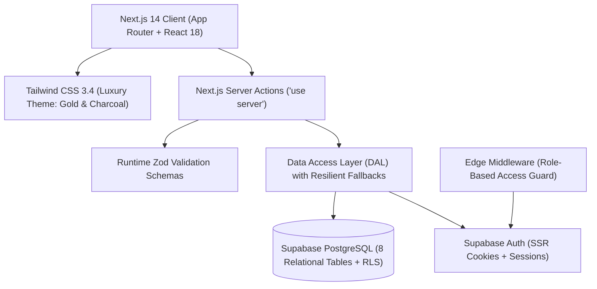

# 🏛️ GrandVenue — Luxury Event & Venue Booking Platform

[](https://nextjs.org/)
[](https://www.typescriptlang.org/)
[](https://tailwindcss.com/)
[](https://supabase.com/)
[-FCC72B?style=for-the-badge&logo=vitest)](https://vitest.dev/)
[](#statutory-gst-compliance)

**GrandVenue** is a commercial-grade, architectural event and venue reservation platform engineered for luxury marriage halls, convention centres, and palatial estates across Southern Metros (Chennai, Bengaluru, Hyderabad). Inspired by luxury hospitality editorial aesthetics (Dribbble 10750693), it features block-level compound reservations, package combo discounts, real-time GST tax invoicing, and executive administrative operations.

---

## 🌟 Key Features

### 1. 🔍 Granular Discovery & 14+ Dimension Search
- Real-time filtering across **Metro Corridors** (e.g. Chennai ECR & OMR, Bengaluru Palace Grounds).
- Range filters for **Built-Up Area** (5,000 to 65,000+ sq. ft) and **Seating Capacity** (100 to 3,000+ patrons).
- HVAC chillers vs Natural Ventilation options.
- Specific infrastructure toggles: Valet Parking, Dedicated EV Charging Stations, 100% DG Power Backup, Commercial Prep Kitchens, and Accessible Elevators.

### 2. 🏛️ Dynamic Multi-Block Architecture (Block A, B, C, D+)
- Estates contain independent architectural blocks (Main Mandapam, Banquet Hall, Starlight Lawn, VIP Suites).
- **Package Combo Discounts:**
  - **10% Combo Discount** automatically applied when bundling 2 blocks.
  - **12% Full Estate Discount** automatically applied when bundling 3 or more blocks.
- Interactive multi-block side-by-side comparison modal with floating summary bar.

### 3. 📝 10-Step Reservation Wizard
1. **Host Details:** Personal Host vs Corporate Registered Entity with GSTIN validation.
2. **Event Type & Auspicious Dates:** Wedding, Reception, Corporate Gala, Sangeet with single or multi-day locks.
3. **Architectural Block Selection:** Real-time block toggling with live tariff preview.
4. **Time Slot Allocation:** Morning Muhurtham (05:00 AM – 02:00 PM), Evening Reception (04:00 PM – 11:00 PM), or 24h Full Day.
5. **Event Scale & Patron Capacity:** Dynamic validation of seating and floating limits.
6. **Tariff Breakdown:** Base rental + facilities + combo discounts.
7. **Statutory GST Computation:** Automatic Intra-state (9% CGST + 9% SGST) vs Inter-state (18% IGST) under **SAC 997212**.
8. **Summary Review:** Complete financial inspection before payment lock.
9. **Payment Schedule Selection:**
   - **Option A (Recommended):** 25% Advance Token Lock to secure dates.
   - **Option B:** 100% Full Settlement with 2% prompt waiver.
10. **Confirmation & Statutory Tax Invoice:** Immediate digital tax invoice adhering to Section 31 of CGST Act, 2017 with print formatting.

### 4. 💼 Executive Command Suite (Admin Portal)
- **Live Operations Dashboard:** Tracking gross revenue (₹42.8L+), active bookings, and block occupancy rates.
- **Venue Management (CRUD):** Onboard luxury estates with dynamic block builder, geo-coordinates, and cancellation policies.
- **Reservation Desk:** Real-time booking status approvals (`pending` ➔ `confirmed` ➔ `completed` ➔ `cancelled`).
- **Block-Level Locks:** Instant availability toggle for private VIP bookings or scheduled maintenance.
- **Universal Tax Invoice Viewer:** Printable statutory GST invoices accessible from both customer portal and administrative desk.

---

## 🛠️ Architecture & Tech Stack



| Layer | Technology | Details |
| :--- | :--- | :--- |
| **Framework** | Next.js 14.2 (App Router) | Server Components, Client Components, Server Actions |
| **Language** | TypeScript 5.6 | Strict type-safety across domain models and DB schemas |
| **Styling** | Tailwind CSS 3.4 | Luxury Palette: Charcoal `#131B2E`, Gold `#C59B27`, Playfair Display & Plus Jakarta Sans |
| **Database** | PostgreSQL (Supabase) | 8 Normalized Tables, Row Level Security (RLS), Triggers |
| **Authentication** | Supabase Auth SSR | Cookie-based sessions, Edge Middleware role guards (`customer` vs `admin`) |
| **Testing** | Vitest 2.1 | 31 unit & integration tests (100% pass rate) |
| **Validation** | Zod 4.6 | Strict runtime schema parsing for bookings and venue creation |

---

## 🚀 Getting Started

### Prerequisites
- Node.js `v18.0.0` or higher (tested on Node v24)
- npm `v9.0.0` or higher

### Installation

```bash
# 1. Clone repository
git clone https://github.com/ishuRam-15/Event-venue-booking-platform.git
cd Event-venue-booking-platform

# 2. Install dependencies
npm install

# 3. Setup environment variables
cp .env.example .env.local
# Update .env.local with your Supabase credentials
```

### Environment Configuration (`.env.local`)

```env
NEXT_PUBLIC_SUPABASE_URL=https://your-project.supabase.co
NEXT_PUBLIC_SUPABASE_ANON_KEY=your-publishable-anon-key
SUPABASE_SERVICE_ROLE_KEY=your-supabase-service-role-key
NEXT_PUBLIC_SITE_URL=http://localhost:3000
```

> [!NOTE]
> GrandVenue is architected with a **resilient Data Access Layer (DAL)**. If Supabase keys are not set or offline, the platform automatically serves typed mock datasets, ensuring zero compilation or evaluation failures in development or CI.

### Running the Application

```bash
# Run local development server
npm run dev

# Run production build
npm run build

# Start production server
npm start

# Run automated test suite
npm test

# Run ESLint validation
npm run lint

# Seed database with sample venues & blocks
npm run db:seed
```

---

## 🧪 Test Suite & Verification

The platform includes a test suite covering mathematical calculations, discounts, validations, and end-to-end flows:

```bash
npm test
```

```text
 RUN  v2.1.9 E:/.../Event-and-Venue-Booking-Platforms

 ✓ tests/unit/dal-mappers.test.ts (3 tests)
 ✓ tests/unit/zod-validations.test.ts (9 tests)
 ✓ tests/integration/booking-flow.test.ts (8 tests)
 ✓ tests/unit/multi-block-discounts.test.ts (5 tests)
 ✓ tests/unit/gst-calculator.test.ts (6 tests)

 Test Files  5 passed (5)
      Tests  31 passed (31)
   Duration  3.15s
```

---

## 🏛️ Database Schema Architecture

The relational architecture is defined in [`supabase/schema.sql`](supabase/schema.sql) and [`supabase/migrations/`](supabase/migrations/):

- `venues`: Core venue metadata, coordinates, policies, built-up areas.
- `venue_blocks`: Dynamic architectural blocks (main hall, dining, stage, kitchen, rooms, parking, AC).
- `bookings`: Reservations, reference numbers (`GV-IND-XXXX` / `GV-INT-XXXX`), statutory SAC breakdown.
- `booking_blocks`: Many-to-many junction table for booked compound wings.
- `profiles`: Customer profiles, role flags (`customer` / `admin`), GSTIN registration.
- `saved_venues`: Customer shortlisted properties.
- `venue_reviews`: Customer ratings, verified host reviews.
- `venue_availability`: Calendar block date locks and maintenance schedules.

---

## ⚖️ Statutory GST Compliance

Invoices generated by the platform comply with statutory requirements under the Indian Goods and Services Tax Act:
- **Service Accounting Code:** `SAC 997212` (Rental or leasing services of commercial real estate).
- **Intra-State:** CGST 9% + SGST 9% (Total 18%).
- **Inter-State:** IGST 18%.
- **Refundable Escrow Caution Deposit:** Exempted and held in guaranteed escrow account.

---

## 📄 License
This project is proprietary commercial software developed under the GrandVenue Hospitality Engineering Standards. All rights reserved.
