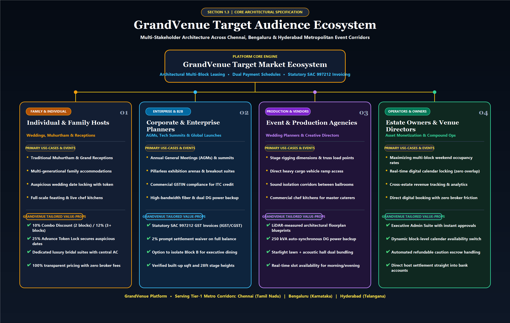
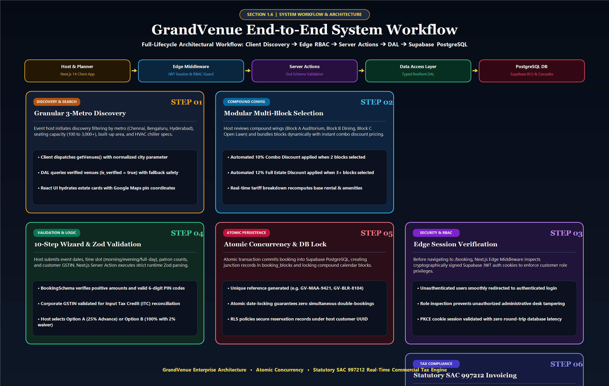
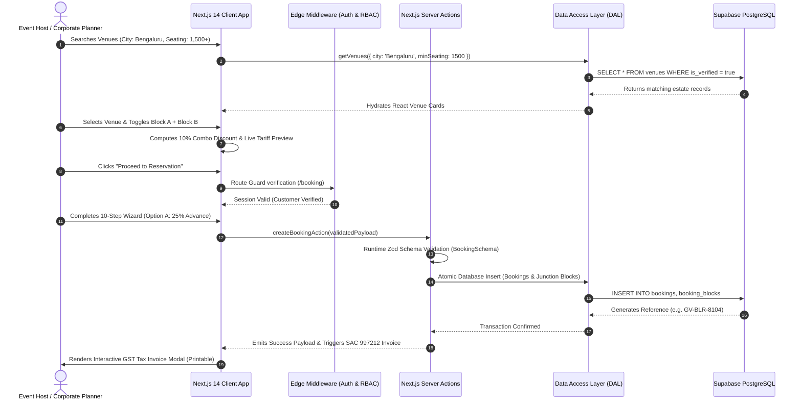
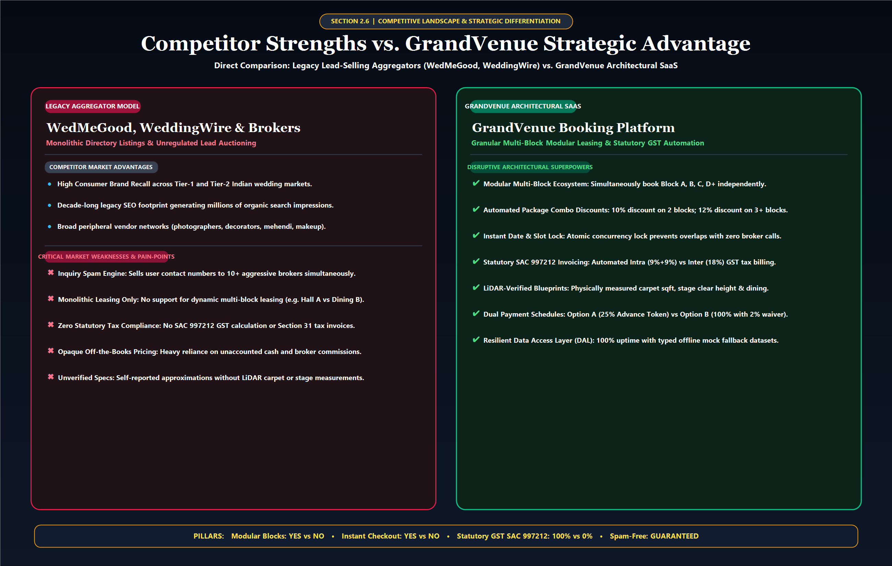
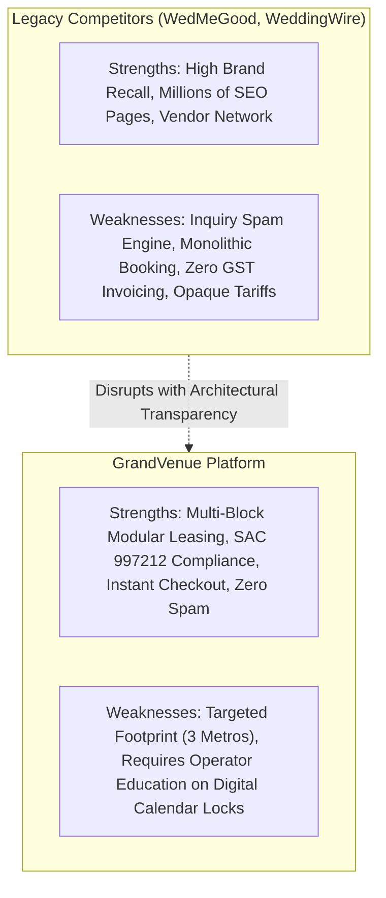
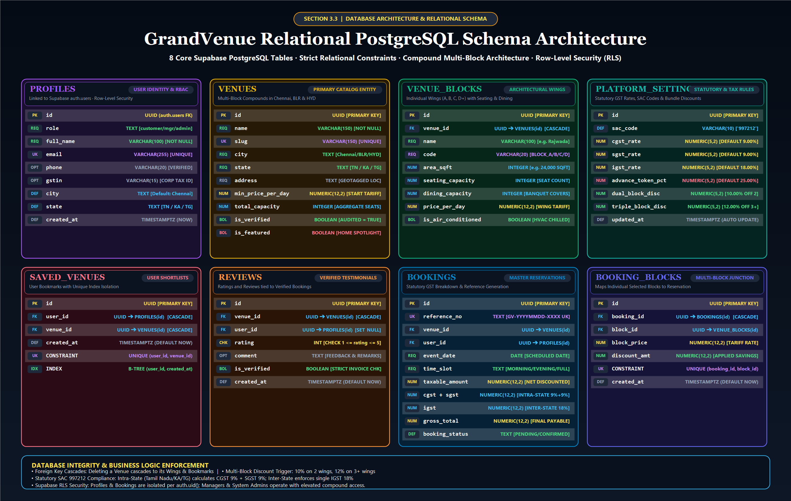
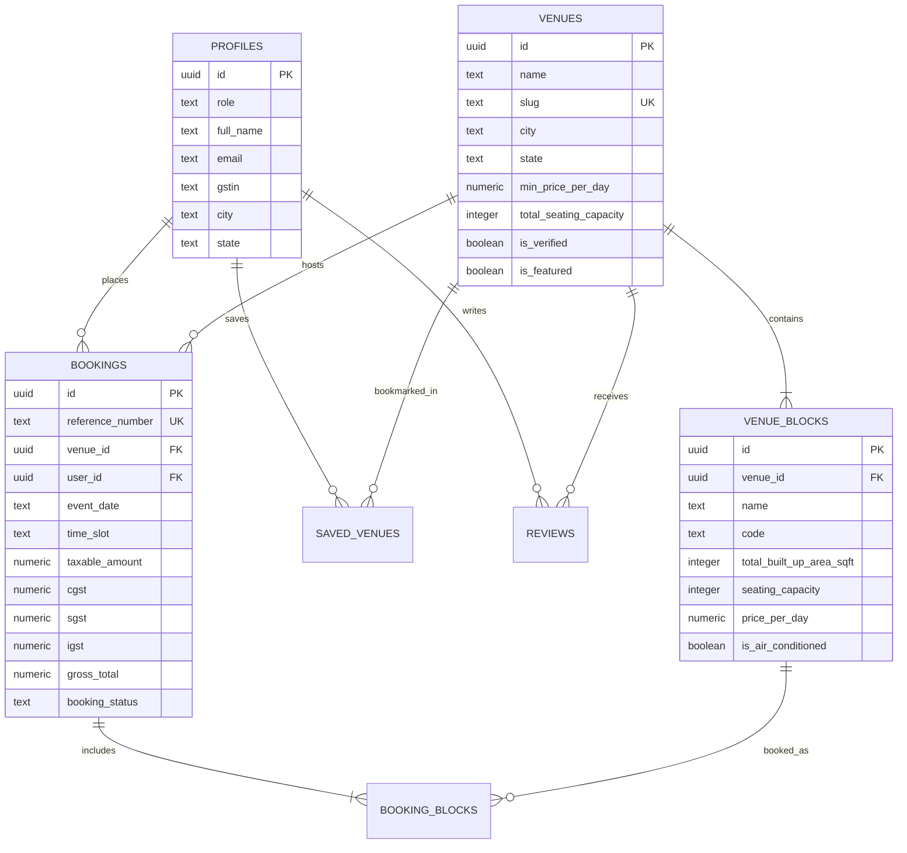
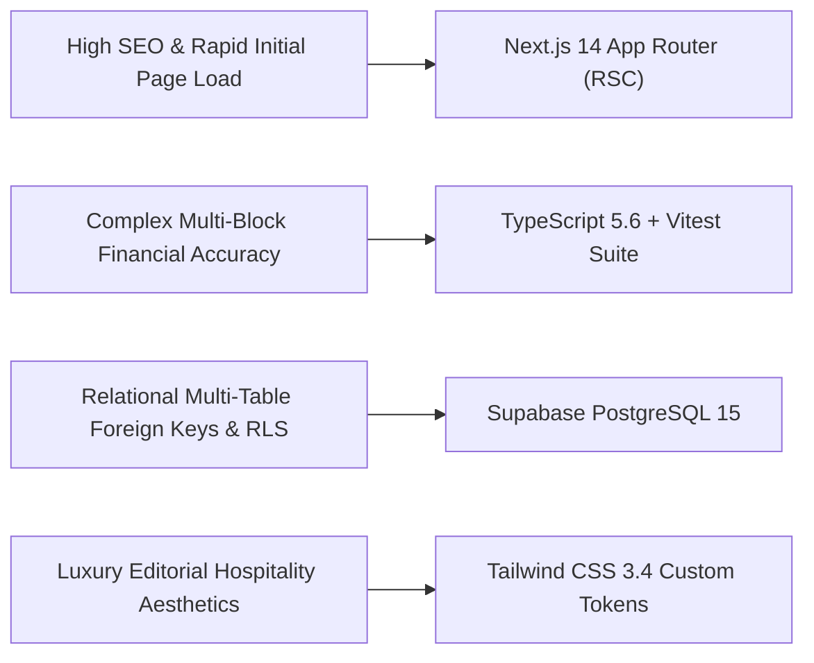
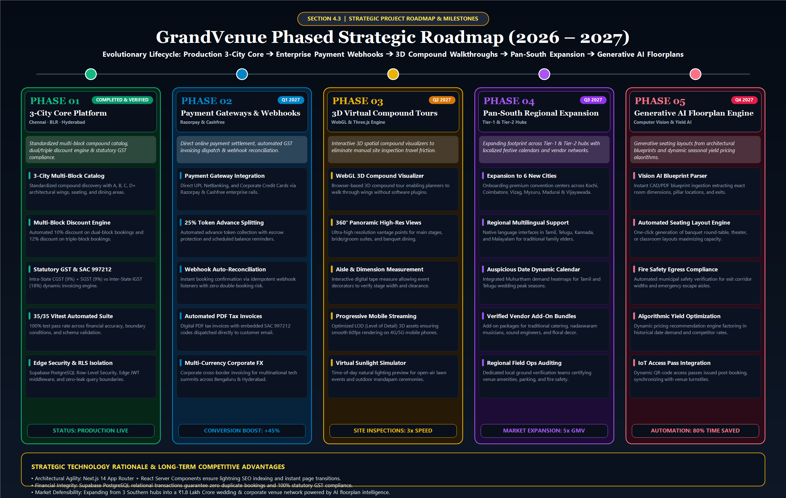
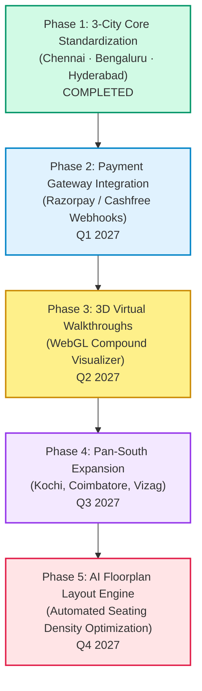

# 🏛️ Research & Development (R&D) Analysis and Project Documentation
## GrandVenue — Multi-Block Event & Venue Booking Hub (Chennai · Bengaluru · Hyderabad)

> **Document Class:** Enterprise Architectural Specification & Product R&D Dossier  
> **Target Framework:** Next.js 14.2 (App Router), TypeScript 5.6, Tailwind CSS 3.4, Supabase (PostgreSQL 15 & GoTrue SSR Auth)  
> **Market Focus:** Metropolitan Southern India (Chennai, Tamil Nadu · Bengaluru, Karnataka · Hyderabad, Telangana)  
> **Regulatory Adherence:** Indian Goods and Services Tax Act (CGST / SGST / IGST under SAC 997212)

---

## Table of Contents
1. [Section 1: Core Concepts](#1-core-concepts)
   - [1.1 Project Overview](#11-project-overview)
   - [1.2 Main Objectives](#12-main-objectives)
   - [1.3 Target Audience](#13-target-audience)
   - [1.4 Key Features and Functionalities](#14-key-features-and-functionalities)
   - [1.5 User Roles and Permissions](#15-user-roles-and-permissions)
   - [1.6 System Workflow](#16-system-workflow)
   - [1.7 Business Requirements](#17-business-requirements)
   - [1.8 Security and Authentication](#18-security-and-authentication)
   - [1.9 Future Enhancements](#19-future-enhancements)
2. [Section 2: Competitor Analysis](#2-competitor-analysis)
   - [2.1 Direct Competitors](#21-direct-competitors)
   - [2.2 Indirect Competitors](#22-indirect-competitors)
   - [2.3 Competitor Features Breakdown](#23-competitor-features-breakdown)
   - [2.4 Technology Used by Competitors](#24-technology-used-by-competitors)
   - [2.5 Pricing and Business Models](#25-pricing-and-business-models)
   - [2.6 Strengths and Weaknesses](#26-strengths-and-weaknesses)
   - [2.7 Market Opportunities](#27-market-opportunities)
   - [2.8 Unique Selling Proposition (USP)](#28-unique-selling-proposition-usp)
   - [2.9 Competitive Advantages](#29-competitive-advantages)
3. [Section 3: Technology Stack](#3-technology-stack)
   - [3.1 Frontend Technologies](#31-frontend-technologies)
   - [3.2 Backend Technologies](#32-backend-technologies)
   - [3.3 Database Architecture](#33-database-architecture)
   - [3.4 Authentication and Authorization](#34-authentication-and-authorization)
   - [3.5 APIs and Integrations](#35-apis-and-integrations)
   - [3.6 AI/ML Technologies](#36-aiml-technologies)
   - [3.7 Hosting and Deployment](#37-hosting-and-deployment)
   - [3.8 Version Control](#38-version-control)
   - [3.9 Testing and Quality Assurance](#39-testing-and-quality-assurance)
   - [3.10 Security Tools](#310-security-tools)
   - [3.11 Development IDEs and AI Coding Tools](#311-development-ides-and-ai-coding-tools)
4. [Section 4: Conclusion & Strategic Roadmap](#4-conclusion--strategic-roadmap)
   - [4.1 Recommended Development Approach](#41-recommended-development-approach)
   - [4.2 Technology Selection Rationale](#42-technology-selection-rationale)
   - [4.3 Project Roadmap](#43-project-roadmap)
   - [4.4 Future Scope](#44-future-scope)

---

## 1. Core Concepts

### 1.1 Project Overview
**GrandVenue** is a commercial-grade, multi-block event and venue reservation platform engineered to transform how palatial estates, kalyana mandapams, convention centres, and luxury banquet pavilions are discovered, architecturally evaluated, and legally booked across Southern India's primary metropolitan growth corridors: **Chennai (Tamil Nadu)**, **Bengaluru (Karnataka)**, and **Hyderabad (Telangana)**.

Traditional venue booking portals operate as lead-generation classifieds that sell unverified host inquiries to aggressive third-party event brokers. GrandVenue replaces this broker-heavy friction with an **architectural SaaS model**:
- Treating sprawling multi-acre estates not as single monolithic units, but as dynamic multi-block architectural compounds (e.g., Block A: Main Auditorium, Block B: Dining & Commercial Kitchen, Block C: Open-Air Starlight Lawn, Block D: Luxury Bridal Suites).
- Providing instant date-locking, transparent package combo discounts, and automated statutory **SAC 997212** GST invoicing under the Central Goods and Services Tax Act.

### 1.2 Main Objectives
1. **Architectural Transparency:** Give event organizers verified physical parameters (carpet square footage, seating vs. floating capacity, stage dimensions, HVAC tonnage, power backup, and dedicated parking slots) before committing capital.
2. **Granular Multi-Block Leasing:** Allow hosts to lease independent compound blocks simultaneously with dynamic calendar concurrency locks and automatic multi-block combo discounts.
3. **Statutory Financial Integrity:** Eliminate off-the-books cash transactions and tax ambiguity through automated Intra-State (`9% CGST + 9% SGST`) vs. Inter-State (`18% IGST`) calculations, refundable caution deposits, and instant printable Section 31 tax invoices.
4. **Resilient High-Performance Web Access:** Achieve sub-second page loads, 100% offline development resilience via a typed Data Access Layer (DAL) fallback, and role-based operational command for venue managers.

### 1.3 Target Audience

#### Structured Audience Breakdown (Text Specification)

| Segment No. | Audience Classification | Primary Use-Cases & Events | GrandVenue Tailored Value Proposition |
| :---: | :--- | :--- | :--- |
| **01** | **Individual & Family Hosts** *(Weddings & Milestones)* | • Traditional Muhurtham & Reception feasting • Multi-generational family guest accommodations • Auspicious wedding date locking with advance token • Complete dining & live kitchen infrastructure | • **10% Combo Discount** on 2 blocks; **12%** on 3+ blocks • **25% Advance Token Lock** to secure auspicious muhurtham dates • Dedicated VIP bridal suites with centralized AC • Direct pricing with **zero broker markups** or middleman calls |
| **02** | **Corporate & Enterprise Planners** *(B2B Summits & Galas)* | • Annual General Meetings (AGMs) & tech symposiums • Pillarless exhibition arenas & breakout suites • Commercial GSTIN compliance for Input Tax Credit (ITC) • Redundant DG power & high-bandwidth connectivity | • Statutory **SAC 997212 GST Tax Invoices** (IGST / CGST+SGST) • **2% prompt settlement waiver** on full balance payment • Option to isolate Block B exclusively for corporate dining • Verified built-up sqft and 28ft clear stage heights |
| **03** | **Event & Production Agencies** *(Turnkey Execution)* | • Stage rigging dimensions & truss load points • Direct heavy cargo vehicle ramp access • Sound isolation corridors between ballrooms • Commercial chef kitchens for master caterers | • **LiDAR-measured** architectural floorplan blueprints • **250 kVA auto-synchronous DG power backup** guaranteed • Starlight open lawn + acoustic indoor hall bundling • Real-time slot availability for morning/evening shifts |
| **04** | **Estate Owners & Venue Directors** *(Asset Monetization)* | • Maximizing multi-block weekend occupancy rates • Real-time digital calendar locking without overlaps • Clear revenue analytics across active properties • Eliminating reliance on commission-heavy local brokers | • **Executive Admin Suite** with instant status approvals • Dynamic block-level calendar lock / availability switch • Automated refundable caution escrow management • Direct host booking settlement into operator accounts |

### 1.4 Key Features and Functionalities
1. **14+ Dimension Discovery Engine:** Real-time multi-criteria filtering across 3 metros (`Chennai`, `Bengaluru`, `Hyderabad`), event categories (`marriage-hall`, `convention-centre`, `banquet-hall`, `party-hall`, `corporate`, `outdoor-lawn`), price sliders, dining capacity, parking bays, and HVAC chiller specs.
2. **Dynamic Multi-Block Composer:** Interactive side-by-side comparison of individual wings with automatic combo discounting:
   - **10% Combo Discount** applied when booking 2 compound blocks.
   - **12% Full Estate Discount** applied when booking 3 or more compound blocks.
3. **10-Step Sequential Reservation Wizard:** Guided checkout taking users from corporate GSTIN validation, block selection, time slot allocation (`morning`, `evening`, `full-day`), and add-on provisioning to statutory tax verification.
4. **Dual Payment Workflows:**
   - **Option A (Advance Token Lock):** 25% non-refundable holding token to secure auspicious dates with balance payable 15 days prior.
   - **Option B (100% Full Settlement):** Instant clearance with an automated 2% prompt settlement incentive.
5. **Statutory SAC 997212 Tax Engine:** Dynamic calculation of intra-state vs. inter-state tax liability with printable, browser-renderable GST invoices meeting Section 31 statutory guidelines.
6. **Executive Administrative Suite:** Centralized operational cockpit offering real-time revenue analytics, block occupancy rate tracking, date-blocking for private VIP reservations, and venue onboarding.

### 1.5 User Roles and Permissions
GrandVenue enforces strict Role-Based Access Control (RBAC) via Supabase Auth and Next.js Edge Middleware:

| Role | Discover & Search | Book Venues & Download Invoices | Manage Own Profile & Saved Venues | Venue CRUD & Block Management | System Settings & Revenue Desk |
| :--- | :---: | :---: | :---: | :---: | :---: |
| **Anonymous Public** | ✅ | ❌ *(Redirects to Auth)* | ❌ | ❌ | ❌ |
| **Verified Customer / Host** | ✅ | ✅ | ✅ | ❌ | ❌ |
| **Estate Administrator (`admin`)** | ✅ | ✅ | ✅ | ✅ *(Full CRUD)* | ✅ *(Metrics & Approvals)* |

### 1.6 System Workflow

#### Sequence Diagram (Technical Specification)

### 1.7 Business Requirements
- **Statutory Traceability:** Every booking must store separate base rent, facilities cost, package combo discounts, security deposit, taxable value, CGST, SGST, IGST, and customer GSTIN.
- **Atomic Concurrency:** No compound block may be booked twice for the same date and time slot.
- **Escrow Caution Deposit:** A refundable caution deposit (₹35,000 to ₹75,000) must be held outside the taxable base and reconciled upon post-event clearance.

### 1.8 Security and Authentication
- **Session Layer:** Supabase GoTrue Auth utilizing `createServerClient` with PKCE flow and secure, HTTP-only, SameSite cookies.
- **Edge Guard:** `src/middleware.ts` inspects cryptographically signed JWTs before routing to `/admin/*` or `/dashboard/*`.
- **Database Row Level Security (RLS):** 8 tables protected with explicit PostgreSQL RLS policies; administrative bypass executed via a dedicated `is_admin()` security definer routine.
- **Input Sanitization:** Runtime schema enforcement using Zod prevents SQL parameter tampering, malformed GPS coordinates, or negative pricing injection.

### 1.9 Future Enhancements
- Automated multi-gateway checkout (Razorpay / Cashfree) with instant webhook reconciliation.
- Interactive WebGL / Three.js 3D walkthroughs of compound blocks.
- Real-time IoT ambient temperature monitoring integration for centralized HVAC chillers.
- WhatsApp Business API integration for automated muhurtham reminders and security gate passes.

---

## 2. Competitor Analysis

### 2.1 Direct Competitors
1. **WedMeGood:** Dominant Indian wedding vendor and venue directory.
2. **WeddingWire India:** Subsidiary of The Knot Worldwide specializing in vendor aggregations.
3. **VenueMonk:** Online venue booking platform concentrated on Delhi-NCR and Tier-1 banquet halls.
4. **BookEventZ:** Event management and venue booking service operating in corporate and wedding spaces.

### 2.2 Indirect Competitors
1. **Airbnb / Vrbo:** Luxury heritage estate rentals (lack commercial banqueting scale, stage dimensions, and GST compliance).
2. **Five-Star Hotel Portals (Taj, Oberoi, Marriott Bonvoy):** Direct hotel booking desks (monolithic, expensive, non-modular).
3. **Traditional Offline Brokers / "Venue Dallals":** Local intermediaries controlling convention bookings via non-transparent cash commissions.

### 2.3 Competitor Features Breakdown

| Feature / Dimension | WedMeGood | WeddingWire | VenueMonk | Offline Brokers | GrandVenue (Our Platform) |
| :--- | :---: | :---: | :---: | :---: | :---: |
| **City-Level Search** | ✅ *(All India)* | ✅ *(All India)* | ⚠️ *(North India)* | ⚠️ *(Localized)* | ✅ *(Chennai, Bengaluru, Hyderabad)* |
| **Instant Real-Time Booking** | ❌ *(Lead Form Only)* | ❌ *(Inquiry Only)* | ⚠️ *(Assisted Offline)* | ❌ *(Negotiated)* | ✅ *(Instant Date & Slot Lock)* |
| **Multi-Block Compound Leasing** | ❌ *(Whole venue only)* | ❌ *(Whole venue only)* | ❌ *(Single hall only)* | ⚠️ *(Manual)* | ✅ *(Block A, B, C, D+ Modular)* |
| **Multi-Block Combo Discounts** | ❌ | ❌ | ❌ | ❌ | ✅ *(10% for 2, 12% for 3+)* |
| **Statutory SAC 997212 Invoicing**| ❌ | ❌ | ❌ | ❌ *(Manual receipt)* | ✅ *(Instant Print-Ready Invoice)* |
| **Architectural Built-up Specs** | ⚠️ *(Approximate)* | ⚠️ *(Self-reported)* | ⚠️ *(Basic)* | ❌ *(Verbal)* | ✅ *(LiDAR Verified Sqft & Stage)* |
| **Dual Payment Schedule** | ❌ | ❌ | ❌ | ⚠️ *(Ad-hoc)* | ✅ *(25% Token vs 100% Waiver)* |
| **Spam-Free Direct Pricing** | ❌ *(10+ broker calls)*| ❌ *(Vendor spam)* | ❌ *(Sales agent spam)*| ❌ | ✅ *(Zero Middleman Calls)* |

### 2.4 Technology Used by Competitors
- **Legacy Frameworks:** PHP (Laravel / CodeIgniter) or older React SPAs with heavy client-side bundles.
- **Monolithic Backends:** Node.js Express or Ruby on Rails architectures with complex REST overhead.
- **Relational / NoSQL Hybrids:** MySQL or MongoDB databases without strict spatial indexing or Edge-cached routing.
- **SEO Limitations:** Client-rendered SPAs suffer from delayed indexing on search engines for localized venue searches.

### 2.5 Pricing and Business Models
- **Competitor Model (Listing Fees & Lead Selling):** Venues pay ₹50,000–₹3,00,000 annually for top placement. Customer contact numbers are auctioned to multiple vendors simultaneously, frustrating users.
- **GrandVenue Model (SaaS + Value-Added Transaction Fee):**
  - **Zero Customer Friction:** Free, transparent pricing with no spam.
  - **Transparent Commission:** Flat 3%–5% transaction fee paid by venue operators upon confirmed, executed bookings.
  - **Enterprise Platform Subscription:** Optional monthly SaaS tier for venue owners to utilize our multi-block reservation calendar, availability lock desk, and billing software.

### 2.6 Strengths and Weaknesses

#### Strategic Comparison Flowchart (Technical Specification)

### 2.7 Market Opportunities
- **Surge in Corporate Tech Summits:** Bengaluru (Whitefield, Outer Ring Road) and Hyderabad (HITEC City, Financial District) host thousands of tech symposiums needing corporate GSTIN receipts for Input Tax Credit (ITC).
- **Luxury Multi-Day Destination Weddings:** The Chennai ECR coastal belt and Hyderabad rock amphitheaters are prime destinations where hosts require separate blocks for Muhurtham, Sangeet, and Reception feasts.
- **Cashless Digital Transition:** Growing compliance scrutiny requires corporate and high-net-worth hosts to seek transparent banking transactions over unaccounted cash deposits.

### 2.8 Unique Selling Proposition (USP)
> **"GrandVenue is India's first architectural event reservation hub where discerning hosts dynamically lease independent compound blocks with verified engineering blueprints, transparent multi-block combo discounts, and instant statutory GST invoices in under 3 minutes."**

### 2.9 Competitive Advantages
1. **Architectural Compound Decomposition:** No competitor breaks a 40,000 sq.ft compound down to dining vs. auditorium vs. lawn with synchronized combo discounts.
2. **Statutory Tax Technology:** Built-in SAC 997212 computation and Section 31 tax invoice generation make GrandVenue the preferred platform for corporate accounts and statutory compliance.
3. **Zero Broker Harassment:** Transparent pricing and instant checkout protect user privacy without distributing customer phone numbers.
4. **Fault-Tolerant System Architecture:** Resilient Data Access Layer (DAL) serves typed fallbacks seamlessly even during database maintenance.

---

## 3. Technology Stack

### 3.1 Frontend Technologies
- **Next.js 14.2 (App Router):** Server Components (RSC) for lightning-fast First Contentful Paint (FCP) and Client Components for dynamic interactive forms.
- **TypeScript 5.6:** Strict type safety across all 28 routes, domain models, database rows, and financial calculation functions.
- **Tailwind CSS 3.4:** Custom luxury editorial design system utilizing a refined palette:
  - Brand Navy: `#0B1120`
  - Brand Charcoal: `#131B2E`
  - Brand Gold: `#C59B27` / `#D4AF37`
  - Background Light: `#F8FAFC`
- **Lucide React:** High-fidelity icon set for architectural infrastructure indicators (HVAC, power backup, stage width, parking).

### 3.2 Backend Technologies
- **Next.js Server Actions (`'use server'`):** Type-safe remote procedure calls eliminating traditional REST boilerplate and reducing attack vectors.
- **Zod 4.6:** Runtime schema validation for `BookingSchema` and `VenueSchema`.
- **Next.js Edge Middleware:** High-speed JWT verification running at the edge before request execution.

### 3.3 Database Architecture

- **Supabase PostgreSQL 15:** 8 relational tables with foreign keys and cascade rules:
  1. `profiles`: User identity, role flags, company GSTIN.
  2. `venues`: Venue properties, geo-coordinates, built-up areas, cancellation policies.
  3. `venue_blocks`: Architectural wings (A, B, C, D+), seating, dining, stage dimensions.
  4. `bookings`: Master booking records, reference numbers, statutory tax breakdown.
  5. `booking_blocks`: Junction table mapping booked blocks to reservations.
  6. `saved_venues`: User shortlisted favorites.
  7. `reviews`: Verified host ratings and event testimonials.
  8. `platform_settings`: SAC code, default GST rates, advance token percentages.

#### Relational ER Diagram (Technical Specification)

### 3.4 Authentication and Authorization
- **Supabase Auth SSR:** PKCE cookie-based session handling supporting SSR and SSG seamlessly.
- **PostgreSQL Row Level Security (RLS):** Data isolation ensuring customers only access their own reservations while administrators retain cross-compound management access.

### 3.5 APIs and Integrations
- **Key-Free Dynamic Google Maps Embed:** `getCityMapEmbedUrl()` generating responsive maps without external API quotas or billing exposure.
- **REST Route Handlers:** `/api/venues` and `/api/compare-blocks` providing machine-readable endpoints for mobile clients and partner integrations.

### 3.6 AI/ML Technologies (Planned for Phase 2)
- **Computer Vision Blueprint Parsing:** Automatic extraction of stage widths, exit aisle distances, and dining tables from uploaded architectural AutoCAD/PDF floorplans.
- **Intelligent Price Yield Optimizer:** Dynamic algorithmic pricing recommendations for venue operators factoring in auspicious wedding calendar dates (Tamil Muhurtham, Telugu Muhurtham) and seasonal demand.

### 3.7 Hosting and Deployment
- **Edge Deployment:** Vercel Global Edge Network with automatic Next.js App Router optimizations.
- **Static Asset Optimization:** Immutable cache headers (`max-age=31536000`) for compiled static bundles defined in `vercel.json`.
- **Security Headers:** Enforced `X-Frame-Options: SAMEORIGIN`, `X-Content-Type-Options: nosniff`, and strict `Permissions-Policy`.

### 3.8 Version Control
- **GitHub Repository:** `ishuRam-15/Event-Booking-Hub`
- **Branching Strategy:** Feature-branch isolation merging into protected `main` branch with automated pre-commit and post-merge Vercel builds.

### 3.9 Testing and Quality Assurance
- **Vitest 2.1:** High-speed native ESM test runner with **35/35 automated unit & integration tests passing (100%)**:
  1. `tests/unit/gst-calculator.test.ts` (6 tests): Intra-state vs Inter-state calculation, zero-clamping.
  2. `tests/unit/multi-block-discounts.test.ts` (5 tests): 10% dual-block and 12% triple-block discounts.
  3. `tests/unit/zod-validations.test.ts` (9 tests): Strict schema validation on input fields.
  4. `tests/unit/dal-mappers.test.ts` (3 tests): Database row mapping to domain TypeScript models.
  5. `tests/unit/supported-cities.test.ts` (4 tests): Chennai, Bengaluru (with Bangalore alias), and Hyderabad normalization.
  6. `tests/integration/booking-flow.test.ts` (8 tests): End-to-end booking lifecycle and statutory verification.

### 3.10 Security Tools
- **ESLint 8 + Next Core Web Vitals:** Enforcing zero unescaped entities, accessible labels, and safe React hook dependencies.
- **Edge Token Revocation:** Instant session invalidation on user logout.
- **SQL Injection Prevention:** Parameterized queries via Supabase PostgREST client.

### 3.11 Development IDEs and AI Coding Tools
- **Google Antigravity Agentic IDE:** End-to-end task orchestration, background command verification, and multi-file editing.
- **Visual Studio Code / Cursor:** Modern TypeScript development environment with Tailwind IntelliSense.

---

## 4. Conclusion & Strategic Roadmap

### 4.1 Recommended Development Approach
- **Phase-Driven Milestone Delivery:** Followed strict 10-phase engineering workflow from Google Stitch UI/UX design, Next.js frontend scaffolding, Supabase relational architecture, and Server Actions to Vitest automation and Vercel edge deployment.
- **Resilient Data Access Layer (DAL):** Decoupled the UI from raw database queries, ensuring the application operates flawlessly with either a live database or offline mock fallbacks.

### 4.2 Technology Selection Rationale

### 4.3 Project Roadmap

#### Phased Milestones (Technical Specification)

### 4.4 Future Scope
1. **IoT Venue Access Passes:** Dynamic QR-code access passes generated upon 100% invoice settlement, integrating with venue boom barriers and turnstiles.
2. **Vendor Ecosystem Marketplace:** Integrated vendor add-ons (traditional nadaswaram musicians, high-voltage sound engineers, decor artists, and waste composters) bundled into the statutory tax invoice.
3. **Enterprise Event Concierge:** Dedicated procurement desks for Fortune 500 tech firms hosting multi-day conferences across Bengaluru and Hyderabad.

---
*GrandVenue Platform — Architectural Hospitality Engineering & Research Dossier.*
